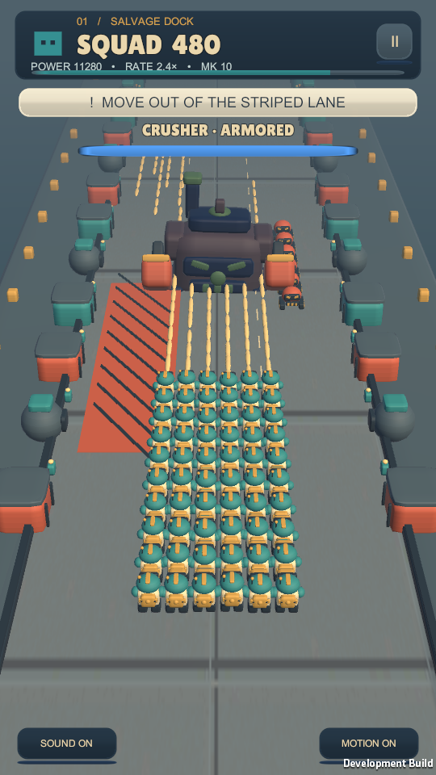

# Salvage Squad

Portrait mobile squad shooter built with Unity 6000.3.26f1 LTS, C# and URP.

Open **outputs/SalvageSquad** as the Unity project, then open `Assets/Scenes/Scrapline.unity` and press Play. Drag horizontally; shooting is automatic.

- [Project setup and current milestone](outputs/SalvageSquad/README.md)
- [AI handoff and gameplay pictures](outputs/AI-Handoff.md)
- [Development instructions](outputs/SalvageSquad/AGENTS.md)

Windows development is supported; physical phone verification is pending. Generated Unity caches, Windows builds and local test logs are excluded. Unity regenerates its Library on first open.
