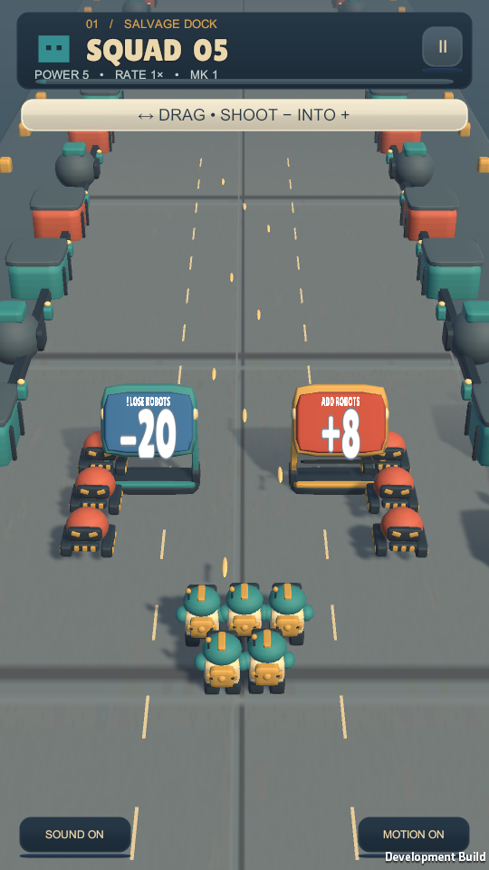
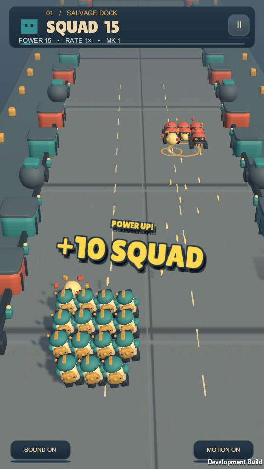
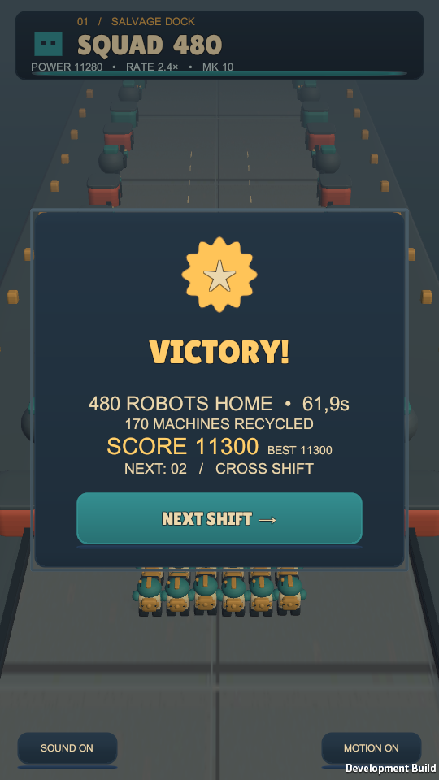
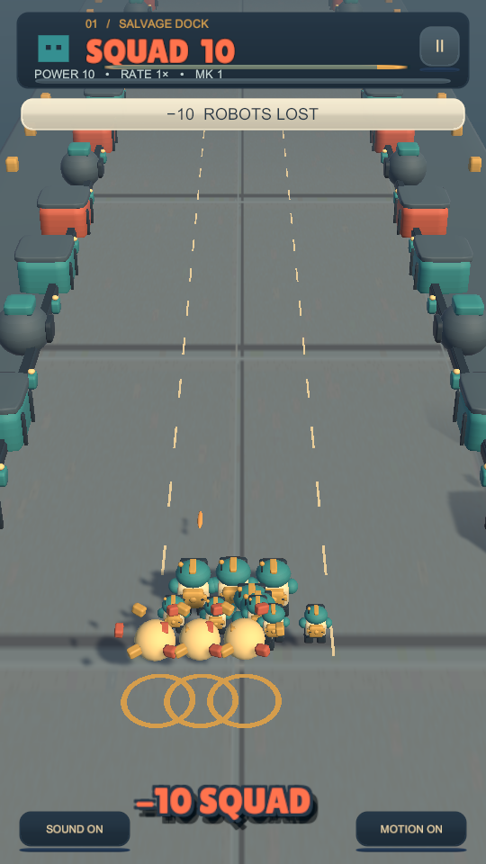
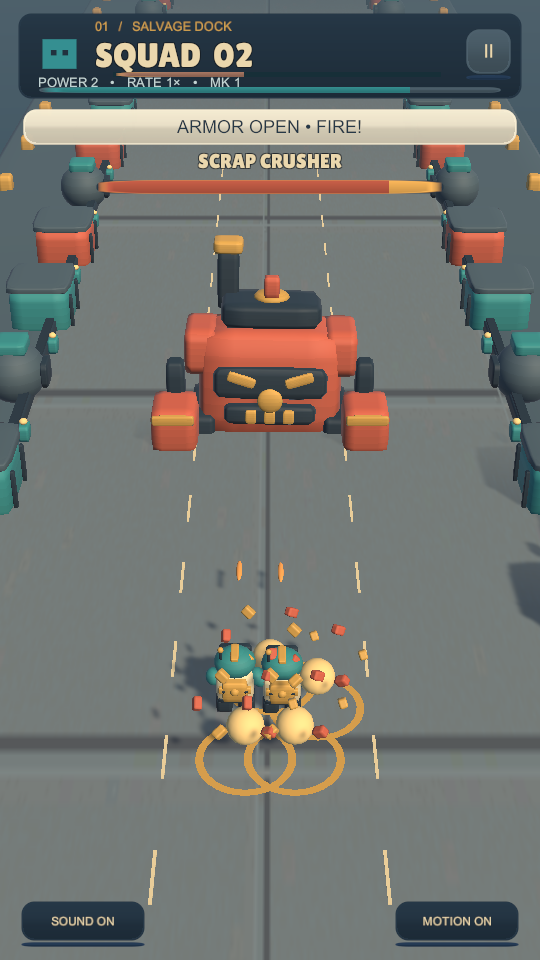
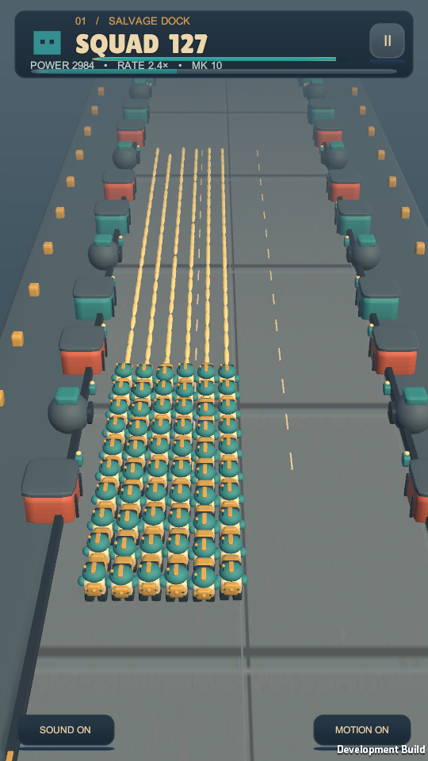
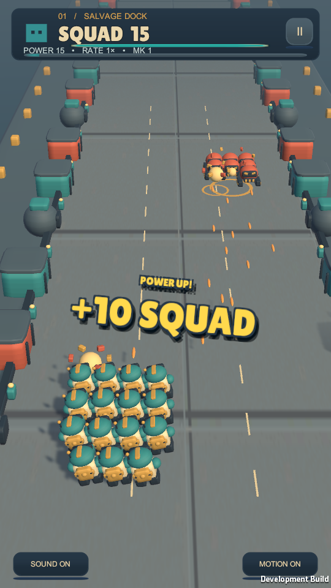

# Salvage Squad — AI handoff

Updated 2026-10-16. Continue the existing project; do not recreate it.

Project: `outputs/SalvageSquad` relative to repository root. Open this folder in Unity Hub.
Unity **6000.3.26f1**, C#, URP. Windows development; iOS signing/device validation deferred.

Read `SalvageSquad/AGENTS.md`, then only task-relevant files. Caveman/Ponytail; no broad scans, new frameworks or meta systems. OmniRoute is unconfigured.

## Completed

- **2026-10-16 game-feel pass:** squad/boss health tween with delayed amber loss, damage flinch and danger colors. Fatal loss resolves in the HUD. Steering responds immediately while robot lean/stretch and small slide/skid sounds add weight. Better-tier guns gain bounded recoil, muzzle and projectile scale, warmer shots and stronger hit flash/debris. Existing controls/content preserved.

- Latest focused polish: clearer reward text hierarchy, delayed medal stamp (reduced motion respected), heavy boss-death impact layered under victory cue. Three changes only; verified and checkpointed sequentially.

- Playable portrait slice: steering, auto-fire, gates/growth, enemies, boss, victory/defeat, pause and replay. Two authored shifts.
- All numeric powerups grow when shot: recruits, multiplier, damage, fire rate and weapon tier. No authored reward cap. Negative recruit gates start at -20; blue negative becomes warm red at zero/positive.
- Paired gates stay fixed at X ±1.7, X-scale 0.5. Choose left at squad center <= -1.1, right at >= 1.1. Middle charges/collects neither; one reward per row.
- Bullets remember squad center at firing, preventing wide-squad farming of both choices from the middle. Side switching preserves older shots' aim; single-lane gates retain their own window.
- Centered KO-style upgrade text keeps punch/tilt/fade; diagonal lines removed. Damage feedback remains above squad. Reduced motion, pause and reset supported.
- Shot range 22; scene projectile speed 32. Camera lens 42, follow 0.4. Up to 60 visible robots represent larger logical squads; MK2+ share heavy art. Fire rate above 3 adds equivalent damage with fractional carry instead of unlimited visible shots.
- Only a living boss makes large striped lane attacks. Death cancels pending damage/warnings; pre-boss hazard rows removed.

## Verified

- **27 EditMode + 37 PlayMode = 64 passing**; Windows development build successful.
- Visible automated touch: novice victory 61.87s/481 survivors; bad route defeat 3.64s. Pause/retry/reset/pools pass; zero dropped shots/enemies. Sampled audio peak 0.394, not a listening assessment.
- 540×960 Windows stress: 60 robots, 64 peak enemies, 405 peak bullets; 16.74ms mean wall frame, 2.17ms mean GPU, 2.627ms gameplay tick, zero gameplay tick allocations and zero drops. No phone claim.
- Inspected real rendered damage, boss ghost, movement/growth, MK10 fire, boss warning and defeat images. Tests cover health trails/reset/reduced motion, boss death, frame-rate steering, routes and pool stability.
## Resume state

Completed: current game-feel pass, tests, build, visible win/loss replay, stress check and screenshots. In progress: none.
**Next exact task:** observe unfamiliar players using steering and reading health/damage; listen to actual game audio and assess boss survival. Tune measured issues within existing systems. Preserve authored shifts and art.
Known limits: phone touch/haptics/performance and human enjoyment remain unverified. Strong builds can kill the boss soon after armor opens. Avoid running PresentationUpgrade or PlayFeelTuning; both overwrite hand edits.
## Relevant files and commands

- Runtime: `SalvageSquad/Assets/Game/Runtime` — GateRow, CombatSystem, SquadController, SliceRun, SliceFeedback.
- Tests: `Assets/Game/Tests`; data: `Assets/Game/Slice`; main scene: `Assets/Scenes/Scrapline.unity`. Preserve TrainingRange.
- **Do not rerun PresentationUpgrade or PlayFeelTuning**; they overwrite manual edits.
- Build: Unity menu **Salvage Squad > Build Windows Prototype**. Player: `WindowsSlice/SalvageSquad.exe`.
- Dev checks: `-sliceQA -sliceQAShort` (novice/bad), `-sliceQADirector` (greedy/low), `-sliceReview`, `-sliceBenchmark`. Launch visibly; engine captures work.
- Evidence from workspace root: `work/gate-choice-EditMode.xml`, `work/gate-choice-PlayMode.xml`, `work/gate-choice-build.log`, `work/gate-choice-live.log`, `work/gate-choice-live.txt`. Earlier stress: `outputs/Performance.txt`, `work/long-shots-stress.log`.

## Current in-game pictures

Unedited 540×960 screenshots from the latest verified Windows build, captured 2026-10-15. Stable copies below avoid routine QA overwrites. Actual gameplay, not concept art or phone validation.

### Gate choices — 2 seconds

Blue -20 and red +8; empty center selects neither.

### Upgrade impact — 4.2 seconds

Centered POWER UP announcement, diagonal lines removed.

### Squad firepower — 30 seconds

Large formation and extended bullet streams. Logical count exceeds the 60-model display limit.

### Boss warning — 60.7 seconds

Armored boss and striped lane telegraph.

### Victory and next shift

[Before this polish pass](Handoff-Images/polish-before-victory.png) · [Medal stamp in motion](Handoff-Images/06-medal-stamp.png)

Latest images inspected from actual renders. Audio layering implemented; subjective listening and physical phone checks pending.

### Latest game-feel captures

